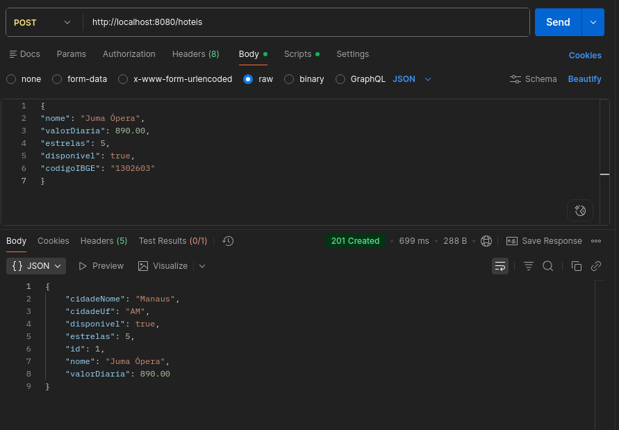
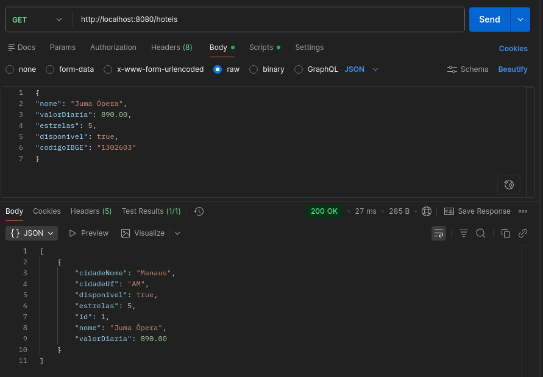
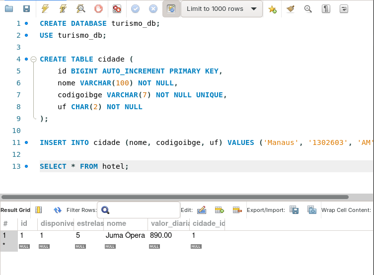

# 🏨 Hotel Service — API RESTful

Atividade prática desenvolvida na disciplina de **Aplicações Distribuídas**, com o objetivo de aplicar conceitos de **APIs RESTful utilizando Spring Boot**.

O projeto consiste em um serviço web para consulta e manipulação de hotéis. Ele foi desenvolvido em etapas: inicialmente com dados simulados em memória e, na terceira atividade, com **arquitetura em camadas e persistência no MySQL**.

## 🚀 Tecnologias utilizadas

- Java
- Spring Boot
- Spring Web
- Spring Data JPA
- Hibernate
- MySQL
- Maven
- IntelliJ IDEA
- Postman
- JSON

---

# 📘 Atividade 1 — Introdução à API RESTful

Nesta primeira etapa, foi desenvolvido um serviço web para realizar a consulta da lista de hotéis cadastrados em memória.

## 📌 Funcionalidade

A aplicação disponibilizava um endpoint para consultar todos os hotéis.

### Endpoint

```http
GET http://localhost:8080/hoteis
```

A requisição retorna informações como:

- ID
- Nome do hotel
- Cidade
- Valor da diária
- Quantidade de estrelas
- Disponibilidade

## 📦 Exemplo de resposta

```json
[
  {
    "id": 1,
    "nome": "Tropical Executive Hotel",
    "cidade": "Manaus",
    "valorDiaria": 450.00,
    "estrelas": 4,
    "disponivel": true
  },
  {
    "id": 2,
    "nome": "Hotel Juma Ópera",
    "cidade": "Manaus",
    "valorDiaria": 890.00,
    "estrelas": 5,
    "disponivel": true
  }
]
```

## 📸 Resultado da execução

A API foi executada localmente e validada através de uma requisição `GET` ao endpoint `/hoteis`, retornando **Status 200 OK** e os dados em formato JSON.


---

# 📗 Atividade 2 — Evolução da API RESTful

Nesta segunda etapa, a API foi evoluída para permitir outras operações sobre os hotéis armazenados em memória.

Além da listagem já implementada anteriormente, foram adicionadas funcionalidades para:

- Buscar um hotel específico por ID;
- Cadastrar um novo hotel;
- Excluir um hotel por ID;
- Consultar a lista atualizada após as operações.

## 🔎 1. Buscar hotel por ID

### Endpoint

```http
GET http://localhost:8080/hoteis/{id}
```

Exemplo:

```http
GET http://localhost:8080/hoteis/1
```

Quando o hotel é encontrado, a API retorna **Status 200 OK** com os dados correspondentes.

Caso o ID informado não exista, a API retorna **Status 404 Not Found**.

### 📸 Evidência — Busca por ID


### 📸 Evidência — Busca por ID Inexistente


---

## ➕ 2. Cadastrar novo hotel

### Endpoint

```http
POST http://localhost:8080/hoteis
```

O cadastro era realizado enviando os dados do novo hotel em formato JSON.

### Exemplo

```json
{
  "nome": "Amazon Ecopark Jungle Lodge",
  "cidade": "Manaus",
  "valorDiaria": 1200.00,
  "estrelas": 5,
  "disponivel": true
}
```

Após o cadastro, a API atribuía um ID ao novo hotel e retornava **Status 201 Created**.

### 📸 Evidência — Cadastro


---

## 🗑️ 3. Excluir hotel por ID

### Endpoint

```http
DELETE http://localhost:8080/hoteis/{id}
```

Exemplo:

```http
DELETE http://localhost:8080/hoteis/2
```

Quando o hotel era encontrado e removido, a API retornava **Status 204 No Content**.

Caso o ID informado não existisse, a API retornava **Status 404 Not Found**.

### 📸 Evidência — Exclusão


---

## 📋 4. Conferir inserção e exclusão

Após realizar o cadastro e a exclusão, uma nova requisição era realizada para consultar a lista atualizada:

```http
GET http://localhost:8080/hoteis
```

O resultado permitia verificar que o hotel de **ID 2 foi removido** e que o novo hotel de **ID 5 foi adicionado**.

### 📸 Evidência — Listagem final


---

## 📚 Endpoints implementados — Atividade 2

| Método | Endpoint | Descrição | Status esperado |
|---|---|---|---|
| `GET` | `/hoteis` | Lista todos os hotéis | `200 OK` |
| `GET` | `/hoteis/{id}` | Busca um hotel por ID | `200 OK` / `404 Not Found` |
| `POST` | `/hoteis` | Cadastra um novo hotel | `201 Created` |
| `DELETE` | `/hoteis/{id}` | Exclui um hotel por ID | `204 No Content` / `404 Not Found` |

---

# 📙 Atividade 3 — Arquitetura em Camadas, DTOs e Persistência com MySQL

Nesta terceira etapa, a API passou a utilizar **arquitetura em camadas** e **persistência de dados em um banco MySQL**, substituindo a lista de hotéis mantida em memória.

Foram implementadas entidades JPA, repositórios, uma camada de serviço e objetos DTO para separar as responsabilidades da aplicação.

## 🏗️ 1. Arquitetura em camadas

- **Controller:** recebe requisições HTTP e devolve respostas.
- **Service:** concentra as regras de negócio.
- **Repository:** realiza as operações de persistência com Spring Data JPA.
- **Entity:** representa as tabelas e os relacionamentos do banco.
- **DTO:** define os dados de entrada e saída da API.

### 📁 Estrutura do projeto

```text
src/main/
├── java/br/edu/ifam/turismo/hotelservice/
│   ├── controller/
│   │   └── HotelController.java
│   ├── dto/
│   │   ├── HotelRequestDTO.java
│   │   └── HotelResponseDTO.java
│   ├── entity/
│   │   ├── Cidade.java
│   │   └── Hotel.java
│   ├── repository/
│   │   ├── CidadeRepository.java
│   │   └── HotelRepository.java
│   ├── service/
│   │   └── HotelService.java
│   └── HotelServiceApplication.java
└── resources/
    └── application.properties
```

## 🗄️ 2. Configuração do MySQL

Foram adicionadas ao `pom.xml` as dependências do **Spring Data JPA** e do **MySQL Connector/J**.

Exemplo de configuração em `application.properties` (substitua as credenciais conforme seu ambiente e não publique senhas reais):

```properties
spring.datasource.url=jdbc:mysql://localhost:3306/turismo_db?createDatabaseIfNotExist=true
spring.datasource.username=root
spring.datasource.password=${DB_PASSWORD}
spring.jpa.hibernate.ddl-auto=update
spring.jpa.show-sql=true
```

O Hibernate realiza o mapeamento das entidades Java para as tabelas do banco de dados.

## 🏙️ 3. Entidades e relacionamento

Foram criadas as entidades **Cidade** (`id`, `nome`, `uf`, `codigoIBGE`) e **Hotel** (`id`, `nome`, `valorDiaria`, `estrelas`, `disponivel`, `cidade`).

A entidade `Hotel` possui um relacionamento **ManyToOne** com `Cidade`: vários hotéis podem pertencer à mesma cidade.

```java
@ManyToOne
@JoinColumn(name = "cidade_id")
private Cidade cidade;
```

A coluna `cidade_id` é a chave estrangeira que relaciona o hotel à cidade.

## 📂 4. Repositories

O `HotelRepository` herda os métodos de `JpaRepository`, incluindo `findAll()` e `save()`.

O `CidadeRepository` possui um método de busca pelo código IBGE:

```java
Optional<Cidade> findByCodigoIBGE(String codigoIBGE);
```

## 📦 5. DTOs

- **HotelRequestDTO:** recebe `nome`, `valorDiaria`, `estrelas`, `disponivel` e `codigoIBGE`. O método `build(Cidade)` transforma a requisição em uma entidade `Hotel`.
- **HotelResponseDTO:** devolve os dados do hotel e os campos `cidadeNome` e `cidadeUf`, sem expor diretamente a entidade `Cidade`.

## ⚙️ 6. Service e Controller

A classe `HotelService` utiliza os repositórios para listar hotéis, buscar a cidade pelo código IBGE e salvar um novo hotel associado a ela.

O `HotelController` recebe as requisições HTTP e delega o processamento ao serviço, deixando as regras de negócio fora do controlador.

### Endpoints da Atividade 3

| Método | Endpoint | Descrição | Status esperado |
|---|---|---|---|
| `POST` | `/hoteis` | Cadastra hotel no MySQL | `201 Created` |
| `GET` | `/hoteis` | Lista hotéis do MySQL | `200 OK` |

> **Observação:** a Atividade 2 documenta os endpoints de busca por ID e exclusão implementados naquela etapa. O Controller apresentado na Atividade 3 do material da disciplina contém apenas os endpoints `GET /hoteis` e `POST /hoteis`.

## 🧪 7. Testes da integração

### 7.1. Inserir cidade no MySQL

Como a atividade não inclui um endpoint para cadastrar cidades, o registro é inserido diretamente no banco:

```sql
USE turismo_db;

INSERT INTO cidade (nome, codigoibge, uf)
VALUES ('Manaus', '1302603', 'AM');
```

### 7.2. Cadastrar hotel — POST

```http
POST http://localhost:8080/hoteis
```

Corpo da requisição (`Body → raw → JSON`):

```json
{
  "nome": "Juma Ópera",
  "valorDiaria": 890.00,
  "estrelas": 5,
  "disponivel": true,
  "codigoIBGE": "1302603"
}
```

**Resultado esperado:** `201 Created`, com o hotel cadastrado e os dados da cidade no formato definido pelo `HotelResponseDTO`.

Exemplo ilustrativo da resposta (o ID depende dos registros do banco):

```json
{
  "id": 1,
  "nome": "Juma Ópera",
  "valorDiaria": 890.00,
  "estrelas": 5,
  "disponivel": true,
  "cidadeNome": "Manaus",
  "cidadeUf": "AM"
}
```

### 📸 Evidência — POST no Postman



### 7.3. Listar hotéis — GET

```http
GET http://localhost:8080/hoteis
```

**Resultado esperado:** `200 OK`, com os hotéis consultados no banco e retornados em formato JSON.

### 📸 Evidência — GET no Postman



### 7.4. Verificar persistência no MySQL

```sql
USE turismo_db;
SELECT * FROM hotel;
```

A consulta permite verificar se o hotel foi salvo na tabela `hotel` e se o campo `cidade_id` referencia a cidade cadastrada.

### 📸 Evidência — Consulta no banco



---

## 📚 Resumo da evolução do projeto

| Etapa | Implementações |
|---|---|
| **Atividade 1** | Consulta de hotéis com dados em memória |
| **Atividade 2** | Busca por ID, cadastro e exclusão em memória |
| **Atividade 3** | Arquitetura em camadas, DTOs, JPA, Hibernate e MySQL |

---

Desenvolvido como atividade acadêmica do curso de **Tecnologia em Análise e Desenvolvimento de Sistemas — IFAM**.
