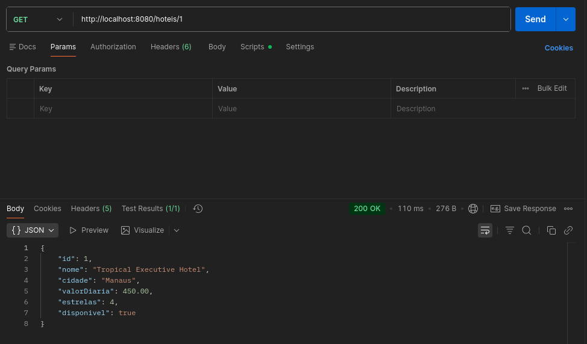
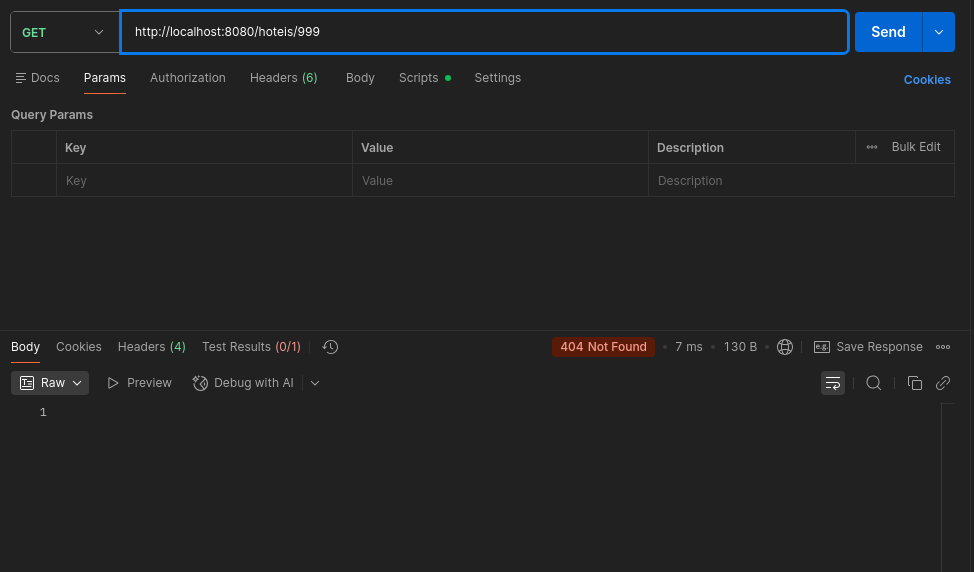
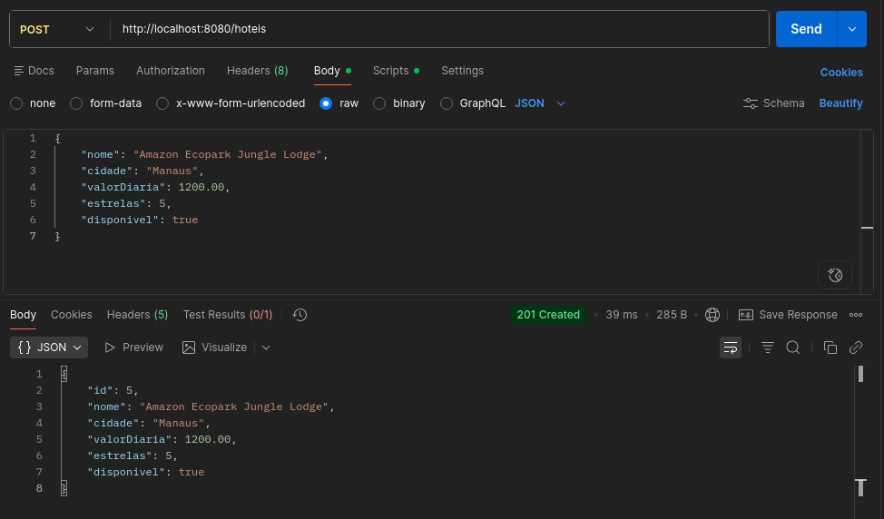
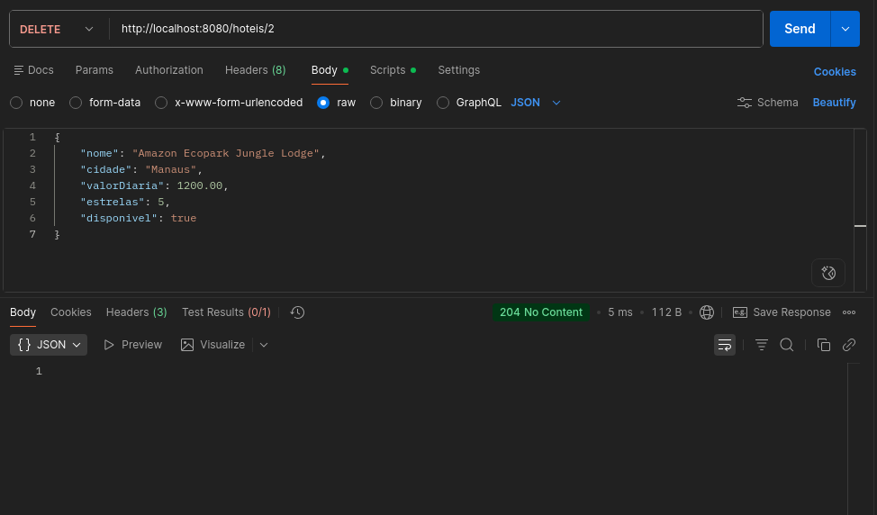
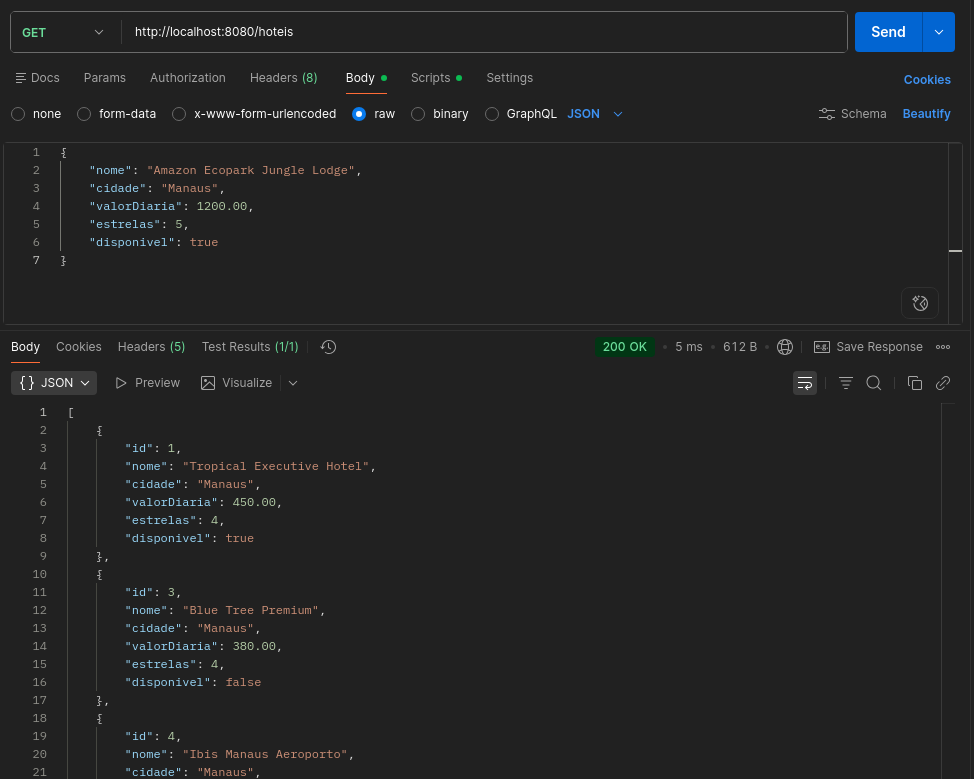

# 🏨 Hotel Service — API RESTful

Atividade prática desenvolvida na disciplina de **Aplicações Distribuídas**, com o objetivo de aplicar conceitos introdutórios de **APIs RESTful utilizando Spring Boot**.

O projeto consiste em um serviço web para consulta e manipulação de hotéis, utilizando dados simulados armazenados em memória.

## 🚀 Tecnologias utilizadas

- Java
- Spring Boot
- Spring Web
- Maven
- IntelliJ IDEA
- Postman
- JSON

---

# 📘 Atividade 1 — Introdução à API RESTful

Nesta primeira etapa, foi desenvolvido um serviço web para realizar a consulta da lista de hotéis cadastrados em memória.

## 📌 Funcionalidade

A aplicação disponibiliza um endpoint para consultar todos os hotéis.

### Endpoint

```http
GET http://localhost:8080/hoteis
```

A requisição retorna informações como:

- ID
- Nome do hotel
- Cidade
- Valor da diária
- Quantidade de estrelas
- Disponibilidade

## 📦 Exemplo de resposta

```json
[
  {
    "id": 1,
    "nome": "Tropical Executive Hotel",
    "cidade": "Manaus",
    "valorDiaria": 450.00,
    "estrelas": 4,
    "disponivel": true
  },
  {
    "id": 2,
    "nome": "Hotel Juma Ópera",
    "cidade": "Manaus",
    "valorDiaria": 890.00,
    "estrelas": 5,
    "disponivel": true
  }
]
```

## 📸 Resultado da execução

A API foi executada localmente e validada através de uma requisição `GET` ao endpoint `/hoteis`, retornando **Status 200 OK** e os dados em formato JSON.


---

# 📗 Atividade 2 — Evolução da API RESTful

Nesta segunda etapa, a API foi evoluída para permitir outras operações sobre os hotéis armazenados em memória.

Além da listagem já implementada anteriormente, foram adicionadas funcionalidades para:

- Buscar um hotel específico por ID;
- Cadastrar um novo hotel;
- Excluir um hotel por ID;
- Consultar a lista atualizada após as operações.

## 🔎 1. Buscar hotel por ID

### Endpoint

```http
GET http://localhost:8080/hoteis/{id}
```

Exemplo:

```http
GET http://localhost:8080/hoteis/1
```

Quando o hotel é encontrado, a API retorna **Status 200 OK** com os dados correspondentes.

Caso o ID informado não exista, a API retorna **Status 404 Not Found**.

### 📸 Evidência — Busca por ID



### 📸 Evidência — Busca por ID Inexistente

---

## ➕ 2. Cadastrar novo hotel

### Endpoint

```http
POST http://localhost:8080/hoteis
```

O cadastro é realizado enviando os dados do novo hotel em formato JSON.

### Exemplo

```json
{
  "nome": "Amazon Ecopark Jungle Lodge",
  "cidade": "Manaus",
  "valorDiaria": 1200.00,
  "estrelas": 5,
  "disponivel": true
}
```

Após o cadastro, a API atribui um ID ao novo hotel e retorna **Status 201 Created**.

### 📸 Evidência — Cadastro



---

## 🗑️ 3. Excluir hotel por ID

### Endpoint

```http
DELETE http://localhost:8080/hoteis/{id}
```

Exemplo:

```http
DELETE http://localhost:8080/hoteis/2
```

Quando o hotel é encontrado e removido, a API retorna **Status 204 No Content**.

Caso o ID informado não exista, a API retorna **Status 404 Not Found**.

### 📸 Evidência — Exclusão



---

## 📋 4. Conferir inserção e exclusão

Após realizar o cadastro e a exclusão, uma nova requisição é realizada para consultar a lista atualizada:

```http
GET http://localhost:8080/hoteis
```

O resultado permite verificar que o hotel de **ID 2 foi removido** e que o novo hotel de **ID 5 foi adicionado**.

### 📸 Evidência — Listagem final



---

## 📚 Endpoints implementados

| Método | Endpoint | Descrição | Status esperado |
|--------|----------|-----------|-----------------|
| `GET` | `/hoteis` | Lista todos os hotéis | `200 OK` |
| `GET` | `/hoteis/{id}` | Busca um hotel por ID | `200 OK` / `404 Not Found` |
| `POST` | `/hoteis` | Cadastra um novo hotel | `201 Created` |
| `DELETE` | `/hoteis/{id}` | Exclui um hotel por ID | `204 No Content` / `404 Not Found` |

---

Desenvolvido como atividade acadêmica do curso de **Tecnologia em Análise e Desenvolvimento de Sistemas — IFAM**.