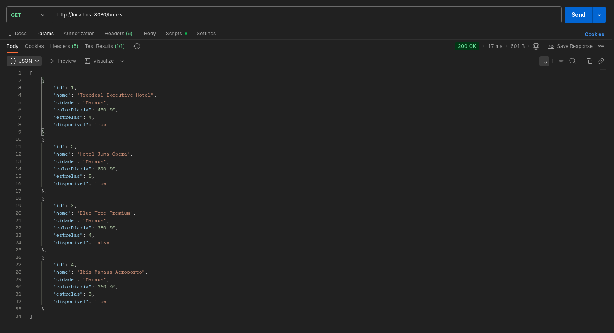

# 🏨 Hotel Service — API RESTful

Atividade prática desenvolvida na disciplina de **Aplicações Distribuídas**, com o objetivo de aplicar conceitos introdutórios de **APIs RESTful utilizando Spring Boot**.

O projeto consiste em um serviço web para consulta de hotéis, disponibilizando dados simulados por meio de um endpoint HTTP.

## 🚀 Tecnologias utilizadas

- Java
- Spring Boot
- Spring Web
- Maven
- IntelliJ IDEA
- Postman
- JSON

## 📌 Funcionalidade

A aplicação disponibiliza um endpoint para consultar a lista de hotéis cadastrados em memória.

### Endpoint

```http
GET http://localhost:8080/hoteis
```

A requisição retorna informações como:

- ID
- Nome do hotel
- Cidade
- Valor da diária
- Quantidade de estrelas
- Disponibilidade

## 📦 Exemplo de resposta

```json
[
  {
    "id": 1,
    "nome": "Tropical Executive Hotel",
    "cidade": "Manaus",
    "valorDiaria": 450.00,
    "estrelas": 4,
    "disponivel": true
  },
  {
    "id": 2,
    "nome": "Hotel Juma Ópera",
    "cidade": "Manaus",
    "valorDiaria": 890.00,
    "estrelas": 5,
    "disponivel": true
  }
]
```

## 📸 Resultado da execução

A API foi executada localmente e validada através de uma requisição `GET` ao endpoint `/hoteis`, retornando **Status 200 OK** e os dados em formato JSON.



---

Desenvolvido como atividade acadêmica do curso de **Tecnologia em Análise e Desenvolvimento de Sistemas — IFAM**.